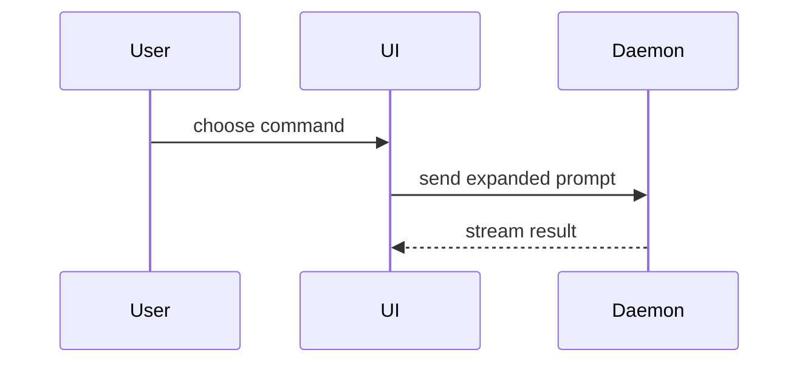

Help the user understand the current topic visually. Skip the preamble and keep prose brief. Pick the smallest view that makes the key point clear. One view is usual, two is fine, more is rare.

- Logic or an algorithm, as pseudocode:

```text
on(save)
  if content is unchanged
    return cached result
  write new content
  return fresh result
```

- Runtime control flow, as a call tree:

```text
submitForm
  createSession
    persistPrompt
    launchAgent
  navigateToSession
```

- UI structure, as a component tree. Used less than the others. Show state and module boundaries that matter, with file paths:

```tsx
<SessionPage> (apps/example/src/routes/session.tsx)
  useSessionEvents()
  <SessionToolbar>
    <RunSkillButton> (packages/ui)
```

- File responsibility or a broad refactor, as a shallow file tree:

```text
src/
├── commands/       # parses user actions
├── sessions/       # owns session state
└── transport/      # sends API requests
```

- Component interaction, control flow or data flow, as Mermaid:



- What changes, when the surrounding shape already exists, as a diff. Match the diff to the topic (component tree, file tree, call tree, control flow). Keep unchanged lines as anchors, mark additions `+` and removals `-`:

```diff
 submitForm
   createSession
     persistPrompt
+    expandSkillMention
     launchAgent
-  navigateToSession
+  navigateToSession
+    subscribeToEvents
```

## Guidance

Place each visual next to the short text it supports. Keep only the calls, files, props, states and boundaries needed for the user's current question. Use your judgement and don't overwhelm the user.

## Related skills

- The point is how a screen looks or lays out: use `mock-up`.
- They want a rendered flowchart, sequence diagram, ERD or architecture picture: use `show-me`.
- Something here was wrong or missing: `skill-feedback` logs it.

## Feedback

End with one line, "Want me to log that? (skill-feedback)", only when one of these happened this turn, and at most once per session:

- the user asked for a different view straight after
- the user trimmed or corrected the output
- no view fit and you improvised
- you had to guess between options
- a hand-off to a sibling skill was redirected

Say nothing when none applied. A user who moves on without comment is not a signal.
